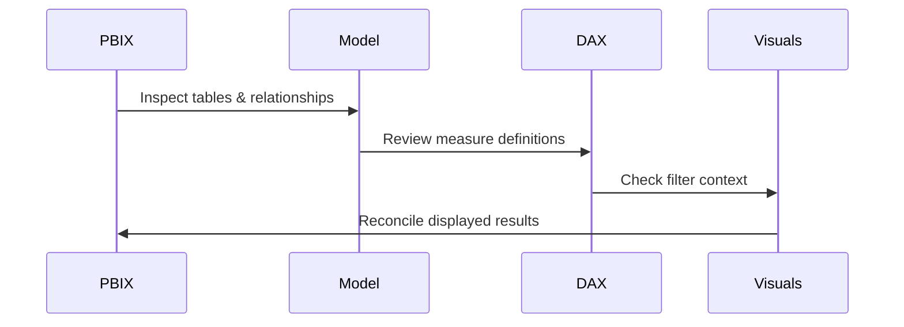

<h1>⚡ DAX / POWER BI — REVIEW SHEET</h1> 

## Review sequence

## Technical test matrix
| TEST AREA | REVIEW QUESTION | STATUS |
|---|---|---|
| Model | Are relationships valid? | To inspect |
| Filter context | Do slicers change measures correctly? | To inspect |
| Aggregation | Is SUM / AVERAGE / DISTINCTCOUNT suitable? | To inspect |
| Time logic | Is the date table configured correctly? | To inspect |
| Formatting | Are units and percentages consistent? | To inspect |

## Artifact index
- [Power BI file](PowerBI%20DAX%20Data%20Visualization.pbix)
- [Technical review notes](docs/TECHNICAL_REVIEW.md)
- [Conceptual project illustration](images/project-overview.svg)

> The SVG is conceptual. A complete DAX inventory and verified screenshot gallery are not documented yet. Do not claim specific measure behaviour until the PBIX is inspected.

## Reviewer sign-off
- [ ] Inventory every measure and definition.
- [ ] Check relationship cardinality.
- [ ] Reconcile headline values to source data.
- [ ] Test blank, zero and multi-select cases.
- [ ] Capture genuine Power BI screenshots.