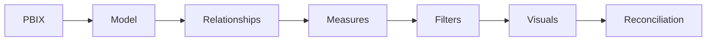

<h1>⚡ POWER BI / DAX — ENGINEERING REVIEW</h1>

## Report inspection circuit

## Asset manifest
| Artifact | Role |
|---|---|
| [Power BI report](PowerBI%20DAX%20Data%20Visualization.pbix) | Main report file |
| [Technical review](docs/TECHNICAL_REVIEW.md) | Review notes |
| [Project overview SVG](images/project-overview.svg) | Conceptual illustration |

## Measure review matrix
| Test | Reviewer question |
|---|---|
| Filter context | Does the measure respond correctly to slicers? |
| Aggregation | Is SUM / AVERAGE / DISTINCTCOUNT appropriate? |
| Relationships | Do dimensions filter intended fact tables? |
| Time logic | Is the date table valid? |
| Formatting | Are units and percentages consistent? |

> Evidence limitation: The SVG is conceptual. No verified screenshot gallery or complete DAX inventory is currently documented. Inspect the PBIX before making claims about specific measures or interactions.

## Sign-off gates
- [ ] Inventory measures and definitions.
- [ ] Check relationship cardinality.
- [ ] Reconcile headline values to source data.
- [ ] Test blank, zero and multi-select cases.
- [ ] Capture genuine report screenshots.